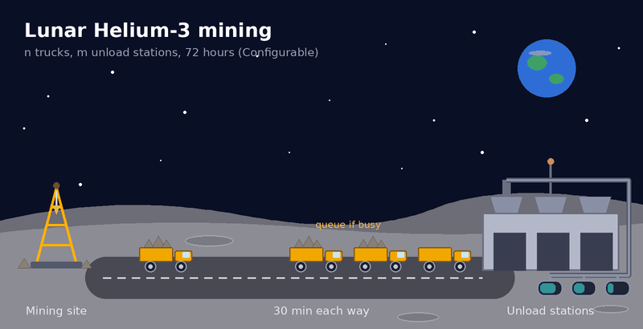
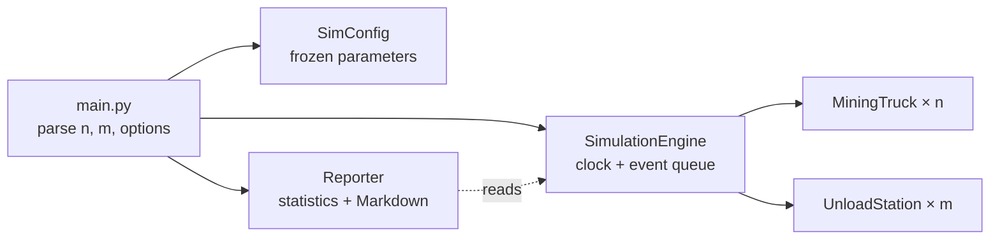

<table>
<tr>
<td><h1>Lunar Helium-3 Mining Simulation</h1></td>
<td align="right" valign="middle">
<a href="https://github.com/sbasu107/lunar-He3-mining-sim/actions/workflows/tests.yml"></a>
</td>
</tr>
</table>

A discrete-event simulation of a lunar Helium-3 mining operation with **n** trucks and **m** unload stations, reporting performance and efficiency statistics for each one.



<p align="center"><sub><i>Animation courtesy of Claude Sonnet 5.5. A simplified view of the actual problem.</i></sub></p>

## Quick Start

The project uses only the Python standard library (3.10+, developed on 3.12). There is nothing to install and no virtual environment is needed. On Windows, use `py` or `python` in place of `python3`.

```bash
python3 main.py                # 10 trucks, 3 stations, 72 hours
python3 main.py 20 5           # 20 trucks, 5 stations
python3 main.py 10 3 --seed 42 --output results/summary_report.md
```

| Argument | Description | Default |
|---|---|---|
| `n` | Number of mining trucks | `10` |
| `m` | Number of unload stations | `3` |
| `--hours H` | Simulated duration in hours | `72` |
| `--seed S` | Random seed for reproducible runs | random |
| `--output PATH` | Also save the Markdown report to `PATH` | not saved |

The report prints to stdout as Markdown. Status messages go to stderr, so `python3 main.py > report.md` captures only the report.

**Required output:** the report for n = 10, m = 3, 72 hours is in [`results/summary_report.md`](results/summary_report.md). It lists loads delivered, time mining, traveling, waiting, and unloading, and utilization for every truck, plus trucks served, busy and idle time, and utilization for every station.

## Approach: Discrete-Event Simulation

A minute-by-minute loop would spend most of its time on ticks where nothing changes. So I modeled only the moments when something *does* change: a truck finishes mining, arrives at a station, starts or finishes unloading, or returns to a site.

The engine keeps these events in a priority queue (`heapq`) ordered by time. It pops the earliest event, jumps the clock straight to it, and handles it, which usually schedules that truck's next event. The cost scales with the number of events, not simulated minutes, so a 72-hour run finishes in a few milliseconds. Timing is also exact, with no tick size to choose.

## Key Design Decision: Queues Without a Queue

The trickiest rule was "join the queue with the shortest wait". A station's wait depends on the trucks already queued there, and their unload times are random.

I solved this by rolling each truck's unload duration **when it arrives** rather than when it starts unloading. Each station then needs only one number, `available_at`: the time it will next be free, counting every truck already assigned to it. An arriving truck:

1. picks the station with the smallest `available_at`,
2. starts unloading at `max(now, available_at)`,
3. pushes that station's `available_at` forward by its unload time.

Because every `available_at` is exact, the smallest one is the true shortest wait. A free station always has the smallest value, which covers "go to the first available station". A truck's unload is scheduled at one station and never moved, which covers "stay in the chosen queue". No queue data structure is needed.

## Architecture



The engine is the only class that changes state. Trucks and stations are plain dataclasses that hold running totals, and `Reporter` reads a finished engine without changing it, so formatting never leaks into simulation logic. The [`simulation` README](simulation/README.md) has the full class diagram, the truck lifecycle, and a walkthrough of each event handler.

## Testing and Reproducibility

```bash
python3 -m unittest discover -s tests -v
```

80 tests run on GitHub Actions for every push and pull request to `main`, using only `unittest`. Most engine tests replace the random generator with a stub that returns fixed durations, so results can be checked against hand calculations. Others check rules that must hold for any seed, such as "every truck's time adds up to the full duration". See the [tests README](tests/README.md) for the full strategy.

The engine draws every random number from its own `random.Random(seed)`, so the same `--seed` always produces the same report.

Each stage of the project was developed on its own branch and merged through a pull request with CI.
