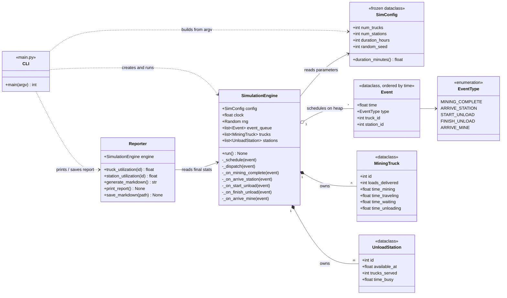
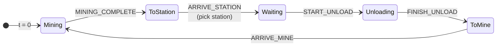

# Lunar Helium-3 Mining Simulation

A discrete-event simulation of a lunar Helium-3 mining operation: **n** mining trucks, **m** unload stations, and a configurable run time (72 hours by default). It reports performance and efficiency statistics for every truck and station.


<p align="center"><sub><i>Animation courtesy of Claude Sonnet 5.5. A simplified view of the actual problem.</i></sub></p>

## Quick Start

The project uses only the Python standard library (3.10+, developed on 3.12). There is nothing to install.

```bash
python3 main.py                # 10 trucks, 3 stations, 72 hours
python3 main.py 20 5           # 20 trucks, 5 stations
python3 main.py 10 3 --seed 42 --output results/summary_report.md
```

| Argument | Description | Default |
|---|---|---|
| `n` | Number of mining trucks | `10` |
| `m` | Number of unload stations | `3` |
| `--hours H` | Simulated duration in hours | `72` |
| `--seed S` | Random seed for reproducible runs | random |
| `--output PATH` | Also save the Markdown report to `PATH` | not saved |

The report prints to stdout as Markdown. Runtime and save messages go to stderr, so `python3 main.py > report.md` captures only the report.

The required report for **n = 10, m = 3, 72 hours** is in [`results/summary_report.md`](results/summary_report.md).

## The Problem

- Every truck starts empty at a mining site. Sites are unlimited, so mining never involves waiting.
- Mining takes a random 1–5 hours. Travel between a site and the stations takes 30 minutes each way.
- Unloading takes a random 30–60 minutes. Each station serves one truck at a time.
- An arriving truck goes to the first free station. If none is free, it joins the queue with the shortest wait and stays in that queue until it has unloaded.

## How I Approached It

My first instinct was a time-stepped loop: advance a clock one minute at a time and update every truck on each tick. Sketching it out, I saw two problems:

1. **Most ticks do nothing.** A truck mining for 4 hours sits through 240 ticks where nothing changes. The work grows with simulated time × number of trucks, not with how much actually happens.
2. **The tick size limits accuracy.** Unload times have 1-minute resolution, so a coarser tick loses precision and a finer one wastes even more work.

What I actually care about are the moments when something changes: a truck finishes mining, arrives at a station, starts or finishes unloading, or returns to a site. That is a **discrete-event simulation (DES)**. I keep a priority queue of future events ordered by time, pop the earliest one, jump the clock straight to it, and handle it. Handling an event usually schedules the truck's next event.

This gave me three things:

- **Speed.** The cost scales with the number of events, not simulated minutes. A 72-hour run with 10 trucks finishes in a few milliseconds, comfortably faster than real time.
- **Exact timing.** Events happen at their true timestamps, so no tick size is involved.
- **Simplicity.** Each truck follows a fixed cycle of five events, so each event type maps to one small handler.

The spec asks for no third-party simulation libraries, so I built the event loop on `heapq` from the standard library.

### Queues without a queue

The queueing rule was the trickiest part. "Join the queue with the shortest wait" means a station's wait has to include the trucks already queued there, and their unload times are random.

I solved this by rolling each truck's unload duration **when it arrives**, not when it starts unloading. Each station then needs only one number, `available_at`: the time it will next be free, counting every truck already committed to it. An arriving truck:

1. picks the station with the smallest `available_at`,
2. starts unloading at `max(now, available_at)`,
3. pushes that station's `available_at` forward by its unload time.

A free station always has the smallest `available_at`, which covers the "first available" rule. Once a truck is assigned, its events are scheduled at that station, which covers the "stays in its queue" rule. No queue data structure is needed.

## Architecture



Each class has one job:

- **`SimConfig`** holds the run parameters. It is frozen, so nothing can change them mid-run.
- **`MiningTruck`** and **`UnloadStation`** are plain state holders that accumulate their own statistics. They contain no simulation logic.
- **`Event`** / **`EventType`** describe *what* happens and *when*. `Event` sorts by time only, so `heapq` orders the queue chronologically.
- **`SimulationEngine`** owns the clock, the event queue, and all entities, and it is the only place where state changes. Handlers are looked up in a dispatch table keyed by `EventType` instead of an `if`/`elif` chain.
- **`Reporter`** reads a finished engine and derives the metrics. Keeping it separate means the engine knows nothing about formatting, and a new output format would be a new method, not an engine change.
- **`main.py`** only parses arguments and wires the pieces together.

### Truck lifecycle

Every truck repeats this cycle until the clock reaches the configured duration:



Waiting takes zero time when a station is free.

## Statistics Reported

| Scope | Metrics |
|---|---|
| System | Total loads delivered, throughput (loads/hour), average truck and station utilization |
| Per truck | Loads delivered, hours mining / traveling / waiting / unloading, utilization |
| Per station | Trucks served, busy and idle hours, utilization |

Truck utilization counts mining, traveling, and unloading as productive time and queue waiting as idle. Station utilization is busy time divided by the simulated duration.

## Engineering Practices

- **Reproducible.** The engine uses its own `random.Random(seed)` instead of the global RNG, so a given `--seed` always produces the same report.
- **Single source of truth for constants.** Every timing value lives in `simulation/config.py`, and all internal time is in minutes. Conversion to hours happens only in reporting.
- **Tested in CI.** Unit tests use `unittest` and run on GitHub Actions for every push and pull request to `main`:

  ```bash
  python3 -m unittest discover -s tests -v
  ```

- **Incremental delivery.** I built the project in stages (config and models, engine, reporting, CLI, tests, final report). Each stage went through its own branch and pull request.

## Project Structure

```
.
├── main.py                 # CLI entry point
├── simulation/
│   ├── config.py           # Constants + SimConfig
│   ├── models.py           # Event, EventType, MiningTruck, UnloadStation
│   ├── engine.py           # SimulationEngine (discrete-event loop)
│   └── reporting.py        # Reporter (statistics + Markdown output)
├── tests/
│   └── test_simulation.py  # Unit tests
├── results/
│   └── summary_report.md   # Required report (n=10, m=3, 72h)
├── assets/
│   └── mining_sim_animation.gif
└── .github/workflows/
    └── tests.yml           # CI
```
