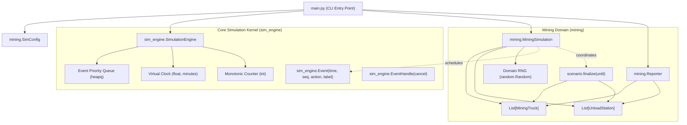

# Decoupled Discrete-Event Simulation Engine and Mining Domain

*   **Author:** Lunar Mining Simulation Team
*   **Status:** Proposed
*   **Date:** 2026-10-24
*   **Reviewers:** Skeptical Architect (`egm-zoom-out`), Comprehension Reader (`egm-comprehension`), Design Critic (`egm-design`), Structural Validator (`egm-structural`), Copy Editor (`egm-style`)
*   **Target Version:** 2.0.0

---

## Overview

This design defines the architectural decoupling of the lunar Helium-3 mining simulation project into two distinct, isolated layers:
1. **Core Simulation Engine (`sim_engine`)**: A reusable, domain-agnostic discrete-event simulation engine responsible for virtual clock advancement, priority-queue event scheduling, and command execution.
2. **Mining Domain (`mining`)**: A standalone business logic package encapsulating lunar mining entities (trucks, stations), operational state machines, station queue heuristics, and metrics reporting.

By separating the general-purpose simulation mechanics from lunar mining rules, the core engine becomes independently testable and reusable for future operational simulations without depending on mining domain code.

---

## The Problem

The existing codebase implements the discrete-event loop and lunar mining domain in a single monolithic engine class (`SimulationEngine` in [`simulation/engine.py`](simulation/engine.py)). Within this class:
* The event queue processes domain-specific enums (`EventType.MINING_COMPLETE`, `EventType.ARRIVE_STATION`, etc.).
* State transition logic, time-credit accounting, and entity collections (`trucks`, `stations`) are held directly on the engine instance.
* Station queueing and availability heuristics (`available_at`) are embedded directly inside event handlers within the engine.
* Reporting and output generation inspect internal fields of `SimulationEngine`.

This coupling introduces several obstacles:
1. **Lack of Reusability**: Introducing a new simulation for a different lunar operation requires copying and modifying the event loop or integrating unrelated domain models into the mining engine.
2. **Extensibility Barriers**: Adding new event types or changing scheduling policies requires modifying the core engine class.
3. **Project Constraints**: Third-party simulation packages (such as `simpy`) are explicitly prohibited by project requirements in [`instructions.md`](instructions.md), requiring a standalone discrete-event simulation kernel.

---

## Goals

* **Domain-Agnostic Core Engine**: Extract a minimal, reusable simulation kernel (`sim_engine`) that manages the priority queue, virtual clock, and event dispatch with zero dependencies on mining-specific concepts.
* **Command Dispatch Pattern**: Implement an event model where scheduled events encapsulate executable callbacks (`action()`), allowing domain code to schedule any event without registering domain enums in the engine.
* **Deterministic Priority Queue Tie-Breaking**: Incorporate an auto-incrementing monotonic sequence counter (`seq`) to guarantee strict FIFO ordering and reproducible execution across runs when multiple events occur at identical virtual timestamps.
* **Event Cancellation**: Provide an event handle abstraction allowing domain logic to cancel scheduled events prior to execution.
* **Domain Autonomy**: Move all mining entities (`MiningTruck`, `UnloadStation`), queue heuristics, state machines, and statistics into a dedicated `mining/` package.
* **Centralized Domain Finalization**: Provide an explicit coordination point (`finalize(until: float)`) in the domain scenario coordinator (`MiningSimulation`) to reconcile in-progress truck activity timers and station busy time at the simulation cutoff.
* **Polymorphic Reporting**: Maintain a flexible reporter interface that accepts either a simulation engine instance or explicit domain entity collections, preserving backward compatibility.
* **Verification & Parity**: Retain full test coverage, determinism, and exact statistical parity with existing test suites across 72-hour benchmark runs.

---

## Non-Goals

* **No Generic Resource Contention in Core Engine**: The core engine will not implement generic queues, resource capacity locks, or semaphore pools. Station queues and resource policies remain domain-specific logic inside the `mining` package.
* **No Third-Party Simulation Dependencies**: The system will not use external simulation libraries (e.g., `simpy`), adhering strictly to the constraints in [`instructions.md`](instructions.md).
* **No Multi-Threaded or Distributed Scheduling**: The simulation kernel will remain single-threaded, priority-queue-driven, and strictly deterministic.
* **No Immediate Multi-Domain Implementations**: While the architecture enables other operational simulations, implementing refinery, power, or maintenance simulations is out of scope for this refactoring.
* **No Changes to External CLI / Report Format**: Command-line arguments, exit codes, and output reports generated for the 72-hour benchmark (`10` trucks, `3` stations) will remain unchanged.

---

## Open Questions

* None (all open architectural questions resolved during brainstorming and review).

---

## Critical User Journeys (CUJs)

### CUJ 1: Executing 72-Hour Lunar Mining Simulation
* **Given**: Standard CLI arguments (10 trucks, 3 stations, 72 hours, seed 42).
* **When**: The user executes `python3 main.py 10 3 --hours 72 --seed 42`.
* **Then**: `main.py` initializes the `sim_engine` scheduler, instantiates the `mining` domain simulation, runs the simulation, finalizes all truck and station states at `t = 72 hours`, and outputs the markdown report matching existing outputs.

### CUJ 2: Developing and Testing an Independent Operational Simulation
* **Given**: A developer building an independent operational component or writing isolated unit tests.
* **When**: The developer imports `sim_engine`, creates custom events with callbacks, and executes the engine.
* **Then**: The simulation executes without importing or referencing any truck, station, or mining code.

---

## Technical Plan (Architecture)

### Architectural Overview

The refactoring splits the monolithic `simulation/` directory into two isolated packages:
1. `sim_engine`: General-purpose discrete-event scheduling kernel.
2. `mining`: Lunar mining domain implementation, configuration, and reporting.



### Component Details

#### 1. Core Simulation Kernel (`sim_engine`)

##### Responsibilities
* Maintain virtual simulation clock advancement in minutes.
* Order scheduled events chronologically and deterministically via a binary min-heap (`heapq`).
* Provide event cancellation and past-time scheduling validation.
* Maintain zero imports or references to domain logic.

##### Module Breakdown & API Contract
* **`sim_engine/event.py`**:
  ```python
  @dataclass
  class EventHandle:
      _cancelled: bool = False

      def cancel(self) -> None:
          self._cancelled = True

      @property
      def is_cancelled(self) -> bool:
          return self._cancelled


  @dataclass(order=True)
  class Event:
      time: float
      seq: int
      action: Callable[[], None] = field(compare=False)
      handle: EventHandle = field(compare=False)
      label: str = field(default="", compare=False)
  ```
  Only `(time, seq)` participate in priority queue comparisons. If two events have identical timestamps, the monotonic sequence integer `seq` enforces strict FIFO ordering.

* **`sim_engine/engine.py`**:
  ```python
  class SimulationEngine:
      def __init__(self) -> None:
          self.clock: float = 0.0
          self._seq: int = 0
          self._queue: list[Event] = []
          self._has_run: bool = False

      def schedule(self, time: float, action: Callable[[], None], label: str = "") -> EventHandle:
          if time < self.clock:
              raise ValueError(f"Cannot schedule event in the virtual past: t={time} < clock={self.clock}")
          handle = EventHandle()
          self._seq += 1
          heapq.heappush(self._queue, Event(time=time, seq=self._seq, action=action, handle=handle, label=label))
          return handle

      def run(self, until: float) -> None:
          if self._has_run:
              raise RuntimeError("SimulationEngine.run() can only be called once")
          self._has_run = True

          while self._queue:
              if self._queue[0].time > until:
                  break
              event = heapq.heappop(self._queue)
              if event.handle.is_cancelled:
                  continue
              self.clock = event.time
              event.action()

          self.clock = until
  ```

#### 2. Mining Domain Package (`mining`)

##### Responsibilities
* Manage mining entities (`MiningTruck`, `UnloadStation`), operational state transitions, and metrics.
* Coordinate shortest-wait unload station selection and queue wait calculations.
* Reconcile partial activity durations for trucks and busy times for stations upon simulation cutoff.
* Generate formatted terminal and Markdown reports.

##### Module Breakdown & API Contract
* **`mining/models.py`**:
  ```python
  class TruckState(Enum):
      MINING = auto()
      TRAVELING = auto()
      WAITING = auto()
      UNLOADING = auto()


  class MiningEventType(Enum):
      MINING_COMPLETE = auto()
      ARRIVE_STATION = auto()
      START_UNLOAD = auto()
      FINISH_UNLOAD = auto()
      ARRIVE_MINE = auto()


  @dataclass
  class MiningTruck:
      id: int
      loads_delivered: int = 0
      time_mining: float = 0.0
      time_traveling: float = 0.0
      time_waiting: float = 0.0
      time_unloading: float = 0.0
      _state: TruckState = TruckState.MINING
      _state_start: float = 0.0
      _station_id: int | None = None


  @dataclass
  class UnloadStation:
      id: int
      available_at: float = 0.0
      trucks_served: int = 0
      time_busy: float = 0.0
  ```

* **`mining/config.py`**:
  ```python
  MIN_MINING_HOURS: int = 1
  MAX_MINING_HOURS: int = 5
  TRAVEL_TIME_MINUTES: int = 30
  MIN_UNLOAD_MINUTES: int = 30
  MAX_UNLOAD_MINUTES: int = 60
  HOURS_TO_MINUTES: int = 60


  @dataclass(frozen=True)
  class SimConfig:
      num_trucks: int = 10
      num_stations: int = 3
      duration_hours: int = 72
      random_seed: int | None = None

      @property
      def duration_minutes(self) -> float:
          return float(self.duration_hours * HOURS_TO_MINUTES)
  ```

* **`mining/scenario.py`**:
  `MiningSimulation` orchestrates the domain:
  * Initializes `self.rng = random.Random(config.random_seed)`.
  * Seeds initial `MINING_COMPLETE` events across all trucks at $t = \text{randint}(1, 5) \times 60$.
  * Dispatches callbacks for truck state transitions:
    - `_on_mining_complete(truck_id)`: transitions truck to `TRAVELING`, schedules `ARRIVE_STATION` at `clock + 30`.
    - `_on_arrive_station(truck_id)`: selects station with minimum `available_at` (tie-broken by lowest `station.id`). Computes `unload_start = max(self.engine.clock, best_station.available_at)` and duration $D \in [30, 60]$. Updates `best_station.available_at = unload_start + D`. Schedules `START_UNLOAD` and `FINISH_UNLOAD`.
    - `_on_start_unload(truck_id, station_id)`: transitions truck to `UNLOADING`.
    - `_on_finish_unload(truck_id, station_id)`: increments loads delivered and station trucks served, credits unload time to station `time_busy`, transitions truck to `TRAVELING`, schedules `ARRIVE_MINE` at `clock + 30`.
    - `_on_arrive_mine(truck_id)`: transitions truck to `MINING`, schedules next `MINING_COMPLETE`.
  * `finalize(until: float)`: Centralized post-simulation reconciliation:
    - For each truck: credits elapsed time `until - truck._state_start` to its current state.
    - If `truck._state == TruckState.UNLOADING`, credits the same elapsed time to `self.stations[truck._station_id].time_busy`.

* **`mining/reporting.py`**:
  `Reporter` with polymorphic initialization:
  ```python
  class Reporter:
      def __init__(
          self,
          target: Any = None,
          *,
          trucks: list[MiningTruck] | None = None,
          stations: list[UnloadStation] | None = None,
          duration_hours: int | None = None,
      ) -> None:
          if target is not None:
              self.trucks = target.trucks
              self.stations = target.stations
              self.duration_hours = target.config.duration_hours
          else:
              self.trucks = trucks or []
              self.stations = stations or []
              self.duration_hours = duration_hours or 0
  ```

#### 3. CLI Entry Point (`main.py`)

##### Responsibilities
* Parse command-line flags and arguments.
* Configure logging verbosity.
* Instantiate `SimConfig`, `SimulationEngine`, and `MiningSimulation`.
* Execute the scenario and generate summary reports.

##### API Contract
```python
def main(argv: list[str] | None = None) -> int:
    args = build_parser().parse_args(argv)
    configure_logging(args.log_level)

    config = SimConfig(
        num_trucks=args.trucks,
        num_stations=args.stations,
        duration_hours=args.hours,
        random_seed=args.seed,
    )

    engine = SimulationEngine()
    scenario = MiningSimulation(engine, config)
    scenario.setup()
    engine.run(until=config.duration_minutes)
    scenario.finalize(until=config.duration_minutes)

    reporter = Reporter(trucks=scenario.trucks, stations=scenario.stations, duration_hours=config.duration_hours)
    reporter.print_report()
    if args.output:
        reporter.save_markdown(args.output)
    return 0
```

### Data Flow and Event Cycle

1. **Scenario Initialization**:
   * `MiningSimulation.setup()` samples initial mining durations using `self.rng` ($1\text{ to }5\text{ hours}$).
   * Schedules initial `MINING_COMPLETE` events using `engine.schedule(time, action, label)`.
2. **Event Dispatch Loop**:
   * `SimulationEngine.run()` peeks at `self._queue[0]`. If `time > until`, execution stops.
   * Pops earliest event `(time, seq)`.
   * Advances virtual clock: `self.clock = event.time`.
   * Invokes `event.action()`.
3. **Domain Execution & Re-Scheduling**:
   * The callback executes inside `MiningSimulation`.
   * Domain models update their internal state and timestamps.
   * Domain calculates next event time and calls `engine.schedule(...)`.
4. **Simulation Finalization**:
   * Queue head exceeds `until` or queue empties. Engine sets `self.clock = until` and returns.
   * Caller invokes `scenario.finalize(until)`.
   * Unfinished truck activities and station busy durations are credited up to `until`.

---

## Alternatives Considered

### Alternatives Comparison Matrix

| Option | Architecture Style | External Dependencies | Simplicity & Footprint | Dispatch Flexibility | Decision |
| :--- | :--- | :--- | :--- | :--- | :--- |
| **Alternative A: SimPy Library** | Generator-based processes (`yield`) | External (`simpy`) | High | High | **Rejected** (Violates project constraints) |
| **Alternative B: Centralized Event Bus** | Global event registry | None | Low (requires dispatch tables) | Medium (payload schemas required) | **Rejected** (Overhead & loose typing) |
| **Alternative C: Engine Resource Queues** | Generic `Resource` abstractions | None | Low (premature abstraction) | Medium | **Rejected** (Queue policies vary across domains) |
| **Alternative D: Individual Entity Listeners** | Observer protocol on models | None | Medium | Low (breaks station state encapsulation) | **Rejected** (Station busy-time reconciliation fails) |
| **Selected Proposal: Command Pattern + Central Finalizer** | Pure Command scheduler + Domain finalizer | None | High (~60 lines kernel) | High (closures encapsulate domain state) | **Accepted** |

### Alternative A: Third-Party Discrete-Event Library (e.g., SimPy)
* **Pros**: Built-in generator-based processes (`yield env.timeout(...)`), mature resource contention primitives (`Resource`, `Container`, `FilterStore`), and extensive documentation.
* **Cons**: Violates project requirements in [`instructions.md`](instructions.md) stating *"Do NOT use any third-party simulation library"*.
* **Reason for Rejection**: Prohibited by project constraints.

### Alternative B: Centralized Event Bus with Engine-Level Handler Registry
* **Pros**: Events remain simple serializable data structures with an event type identifier (e.g., `Event(time, event_type, payload)`). Domain handlers register centrally via `engine.register_handler(event_type, handler)`.
* **Cons**: Forces the engine to maintain and query an internal dispatch table. Requires either loose typing for event payloads (`Any` or `dict`) or complex generic parameterization.
* **Reason for Rejection**: The Command pattern (`Event(time, action=callable)`) is simpler, eliminates the registration table in the engine, provides compile-time type safety via closures, and keeps the engine completely agnostic of domain event schemas.

### Alternative C: Generic Resource Contention and Queuing Inside Core Engine
* **Pros**: Future simulation domains could reuse a common `Resource` class with built-in FIFO waiting queues.
* **Cons**: Introduces speculative complexity before multi-resource requirements exist. The current lunar mining domain does not use an explicit FIFO queue; it uses an optimistic shortest-wait projection based on `station.available_at`. Imposing a generic queue abstraction would require reconciling multiple queuing policies within the engine.
* **Reason for Rejection**: Queuing mechanics are left to domain packages. The core engine remains strictly a time and event scheduler.

### Alternative D: Individual Entity Listeners (`SimulationListener`)
* **Pros**: Follows standard observer pattern where entities receive lifecycle notifications.
* **Cons**: In this simulation's model, `UnloadStation` only stores `available_at` and has no reference to active trucks or dock timestamps. An isolated station listener cannot determine its active busy time from `available_at` at cutoff.
* **Reason for Rejection**: Because `run(until)` is synchronous, domain-wide reconciliation is cleanly coordinated by `MiningSimulation.finalize(until)` in a single pass post-run.

---

## Resolved Decisions

* **Decision 1 (Lifecycle Reconciliation Strategy)**: Discard individual entity listener interfaces. Designate the domain coordinator (`MiningSimulation`) to perform post-simulation reconciliation across trucks and stations via `finalize(until: float)` once `engine.run()` returns.
* **Decision 2 (Random Number Management)**: The core engine manages time and event queues with zero stochastic logic. The domain package owns and seeds its own `random.Random` generator via `SimConfig.random_seed`, ensuring isolated, deterministic simulation streams.
* **Decision 3 (Priority Queue Ordering Contract)**: Events are ordered by `(time: float, seq: int)`. An auto-incrementing monotonic counter `_seq` maintained by `SimulationEngine` guarantees deterministic FIFO order for events occurring at the exact same simulation minute.

---

## Detailed Implementation Plan

### Target Files to Create, Modify, or Migrate

#### 1. `sim_engine/__init__.py` (Create)
*   **Type / Scope**: Python Package Initialization
*   **Proposed Changes**: Export core primitives: `SimulationEngine`, `Event`, and `EventHandle`.
*   **Rationale**: Establishes a clean, centralized public entry point for the reusable simulation framework.

#### 2. `sim_engine/event.py` (Create)
*   **Type / Scope**: Core Framework Module
*   **Proposed Changes**: Define the `Event` dataclass with `time: float`, `seq: int`, `action: Callable[[], None]`, `handle: EventHandle`, and `label: str = ""`. Implement `__lt__` comparison strictly on `(time, seq)`. Define `EventHandle` with `cancel()` and `is_cancelled: bool`.
*   **Rationale**: Implements the Command pattern with deterministic FIFO tie-breaking and event cancellation.

#### 3. `sim_engine/engine.py` (Create)
*   **Type / Scope**: Core Framework Module
*   **Proposed Changes**: Implement `SimulationEngine` managing virtual clock (`clock`), monotonic sequence counter (`_seq`), priority queue (`heapq`), `schedule(time, action, label) -> EventHandle` with past-time guard (`time >= self.clock`), and execution loop `run(until)` with queue head peeking.
*   **Rationale**: Encapsulates the general-purpose discrete-event event loop, completely detached from mining domain models.

#### 4. `sim_engine/README.md` (Create)
*   **Type / Scope**: Documentation
*   **Proposed Changes**: Document the core engine API, Command dispatch model, deterministic tie-breaking, event cancellation, and minimal example usage for any new domain.
*   **Rationale**: Enables independent development of future operational simulation domains without needing to study mining code.

#### 5. `mining/__init__.py` (Create)
*   **Type / Scope**: Python Package Initialization
*   **Proposed Changes**: Export `MiningSimulation`, `SimConfig`, `MiningTruck`, `UnloadStation`, `TruckState`, `MiningEventType`, and `Reporter`.
*   **Rationale**: Defines the public surface for the lunar mining domain package.

#### 6. `mining/config.py` (Create)
*   **Type / Scope**: Domain Configuration Module
*   **Proposed Changes**: Define mining timing constants (`MIN_MINING_HOURS = 1`, `MAX_MINING_HOURS = 5`, `TRAVEL_TIME_MINUTES = 30`, `MIN_UNLOAD_MINUTES = 30`, `MAX_UNLOAD_MINUTES = 60`, `HOURS_TO_MINUTES = 60`) and the `SimConfig` dataclass. Implement `__post_init__` validation ensuring `num_trucks >= 1`, `num_stations >= 1`, and `duration_hours >= 1`.
*   **Rationale**: Isolates mining operational parameters and validation from the core engine.

#### 7. `mining/models.py` (Create)
*   **Type / Scope**: Domain Models Module
*   **Proposed Changes**:
    * Define `TruckState` (`MINING`, `TRAVELING`, `WAITING`, `UNLOADING`) and `MiningEventType` enums.
    * Implement `MiningTruck` tracking operational metrics (`loads_delivered`, `time_mining`, `time_traveling`, `time_waiting`, `time_unloading`).
    * Implement `UnloadStation` tracking `available_at`, `trucks_served`, and `time_busy`.
*   **Rationale**: Encapsulates lunar truck state machines and station availability within the mining domain as plain dataclasses.

#### 8. `mining/scenario.py` (Create)
*   **Type / Scope**: Domain Orchestration Module
*   **Proposed Changes**: Implement `MiningSimulation` class that wires domain entities with `sim_engine.SimulationEngine`. Handles RNG ownership, initial truck event seeding via explicit `setup() -> None`, event callback handlers (`_on_mining_complete`, `_on_arrive_station`, `_on_start_unload`, `_on_finish_unload`, `_on_arrive_mine`), shortest-wait station selection with lowest-id tie-breaking, and `finalize(until: float) -> None` for centralized post-simulation crediting.
*   **Rationale**: Connects domain rules with the engine's Command scheduler without embedding domain logic into the engine class.

#### 9. `mining/reporting.py` (Create)
*   **Type / Scope**: Domain Reporting Module
*   **Proposed Changes**: Implement `Reporter` supporting polymorphic initialization (`Reporter(target: Any = None, *, trucks=None, stations=None, duration_hours=None, seed=None, config=None)`). Provide public metric methods (`total_loads_delivered`, `system_throughput_loads_per_hour`, `truck_utilization`, `average_truck_utilization`, `station_utilization`, `average_station_utilization`). Produces terminal output and Markdown summaries.
*   **Rationale**: Decouples report formatting from engine internals, reading strictly from domain entity states while preserving compatibility with existing test assertions.

#### 10. `mining/README.md` (Create)
*   **Type / Scope**: Documentation
*   **Proposed Changes**: Document the lunar mining scenario rules, state transitions, station selection heuristics, and reporting output structure.
*   **Rationale**: Explains the lunar He-3 mining domain logic as a consumer of `sim_engine`.

#### 11. `simulation/__init__.py` (Modify)
*   **Type / Scope**: Backward-Compatibility Facade
*   **Proposed Changes**: Re-export `SimConfig`, `SimulationEngine` (legacy adapter), `Reporter`, `MiningTruck`, `UnloadStation`, `TruckState`, `Event` (legacy domain event), and `EventType = MiningEventType`.
*   **Rationale**: Preserves compatibility for existing scripts, tests, or benchmarks during transition.

#### 12. `simulation/engine.py` (Modify)
*   **Type / Scope**: Backward-Compatibility Facade
*   **Proposed Changes**: Implement legacy `SimulationEngine` as an adapter wrapping `sim_engine.SimulationEngine` and `mining.MiningSimulation`. Support parameterless `run()`, define `@rng.setter` forwarding to `MiningSimulation.rng`, defer `MiningSimulation.setup()` to `run()`, and provide property forwarding for `clock`, `seed`, `config`, `trucks`, `stations`, and `event_queue`. Bridge log records to `"simulation.engine"`.
*   **Rationale**: Prevents breakage of existing scenario and unit tests that instantiate and configure `simulation.SimulationEngine(config)`.

#### 13. `simulation/models.py`, `simulation/config.py`, `simulation/reporting.py` (Modify)
*   **Type / Scope**: Backward-Compatibility Facade
*   **Proposed Changes**:
    * In `simulation/models.py`: Retain the legacy `Event(time, type, truck_id, station_id)` dataclass definition, export `EventType = MiningEventType`, and re-export `MiningTruck`, `UnloadStation`, and `TruckState` from `mining.models`.
    * In `simulation/config.py` and `simulation/reporting.py`: Re-export all classes and constants from `mining.config` and `mining.reporting`.
*   **Rationale**: Preserves legacy domain `Event` test contracts in `test_models.py` and keeps existing import paths working.

#### 14. `simulation/README.md` (Modify)
*   **Type / Scope**: Documentation
*   **Proposed Changes**: Note that `simulation` is now a compatibility facade over `sim_engine` and `mining`.
*   **Rationale**: Directs future development to the appropriate decoupled packages.

#### 15. `main.py` (Modify)
*   **Type / Scope**: Application Entry Point
*   **Proposed Changes**: Update imports to use `sim_engine.SimulationEngine`, `mining.MiningSimulation`, `mining.SimConfig`, and `mining.Reporter`. Wire engine execution and reporting cleanly, preserving console `stderr` status lines (`Simulated {hours} h in {elapsed * 1000:.1f} ms...` and `Report saved to {path}`).
*   **Rationale**: Serves as the primary reference consumer while honoring console output assertions in `test_cli.py`.

#### 16. `README.md` (Modify)
*   **Type / Scope**: Project Documentation
*   **Proposed Changes**: Update system architecture descriptions, Mermaid diagrams, directory trees, and example code snippets to reflect the separation between `sim_engine` and `mining`.
*   **Rationale**: Ensures project documentation accurately reflects the codebase structure and design decisions.

#### 17. `tests/test_sim_engine.py` (Create)
*   **Type / Scope**: Unit Test Suite
*   **Proposed Changes**: Implement isolated tests for `sim_engine`:
    * Event ordering and priority queue sorting with sequence tie-breaking.
    * Virtual clock advancement and cutoff boundary enforcement (`run(until)`).
    * Command callback invocation and event cancellation via `EventHandle`.
    * Past-time scheduling guard raising `ValueError`.
    * Error handling when `run()` is invoked multiple times on the same engine.
*   **Rationale**: Verifies core scheduler mechanics independently of any mining domain concepts.

#### 18. `tests/test_mining.py` (Create)
*   **Type / Scope**: Domain Unit & Property Test Suite
*   **Proposed Changes**: Implement tests verifying mining scenario logic:
    * Deterministic event cycles using stubbed RNGs.
    * Truck state transitions and cumulative time accounting.
    * Shortest-wait station selection heuristic.
    * Invariant: `time_mining + time_traveling + time_waiting + time_unloading == duration`.
*   **Rationale**: Guarantees that domain rules and mathematical invariants remain fully intact in `mining/`.

#### 19. `tests/test_models.py`, `tests/test_reporting.py`, `tests/test_cli.py`, `tests/test_engine.py` (Modify)
*   **Type / Scope**: Test Suite Maintenance
*   **Proposed Changes**: Update imports and verify that all 91 existing unit tests continue to pass with zero regressions across both the direct packages and the backward-compatibility facade.
*   **Rationale**: Assures 100% test parity and backward compatibility.

#### 20. `tests/README.md` (Modify)
*   **Type / Scope**: Documentation
*   **Proposed Changes**: Document the updated test structure, distinguishing core engine tests (`test_sim_engine.py`) from domain tests (`test_mining.py`, `test_reporting.py`, `test_models.py`).
*   **Rationale**: Keeps developer testing instructions current and actionable.

---

### Step-by-Step Implementation Sequence

1. **Step 1: Core Framework Implementation (`sim_engine/`)**
   * Create `sim_engine/` directory.
   * Implement `sim_engine/event.py` (`Event` dataclass with `seq` tie-breaker and `EventHandle`).
   * Implement `sim_engine/engine.py` (`SimulationEngine` loop with past-time guard, peeking, and monotonic counter).
   * Create `sim_engine/__init__.py`.
   * Implement `tests/test_sim_engine.py` to validate engine isolation.

2. **Step 2: Mining Domain Extraction (`mining/`)**
   * Create `mining/` directory.
   * Implement `mining/config.py` with timing constants and `SimConfig`.
   * Implement `mining/models.py` with plain dataclasses `MiningTruck` and `UnloadStation`.
   * Implement `mining/scenario.py` with `MiningSimulation` managing event callbacks, station selection, and `finalize(until)`.
   * Implement `mining/reporting.py` with polymorphic `Reporter`.
   * Create `mining/__init__.py`.
   * Implement `tests/test_mining.py` to validate mining operations and invariants.

3. **Step 3: Facade and Application Wiring**
   * Refactor `simulation/` modules to re-export and wrap `sim_engine` and `mining`.
   * Update `main.py` to run the simulation via `sim_engine` and `mining`.
   * Run existing test suite (`tests/test_models.py`, `tests/test_reporting.py`, `tests/test_cli.py`, `tests/test_engine.py`) to verify complete backward compatibility.

4. **Step 4: Documentation and Final Polish**
   * Write `sim_engine/README.md` and `mining/README.md`.
   * Update `simulation/README.md`, `tests/README.md`, and top-level `README.md`.

---

### Verification Plan

* **Unit Tests**:
  * Execute `python3 -m unittest discover tests` across all test suites. All existing 91 tests plus new `sim_engine` and `mining` tests must pass cleanly.
* **Deterministic Benchmark Parity**:
  * Run benchmark: `python3 main.py 10 3 --hours 72 --seed 42`.
  * Verify that summary metrics (total loads delivered, truck state breakdown, station busy percentages) match bit-for-bit with the pre-refactoring baseline output.
* **Domain Isolation Check**:
  * Verify that `sim_engine/` contains zero import statements from `mining/` or `simulation/`.
* **Static Analysis**:
  * Compile and syntax check all Python files using `python3 -m py_compile main.py sim_engine/*.py mining/*.py simulation/*.py tests/*.py`.
