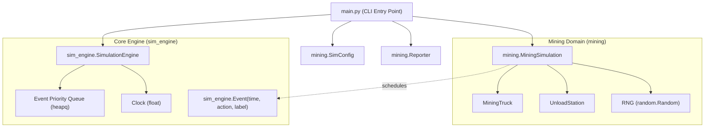

# Skeptical Architect Review: Decoupled Simulation Engine & Mining Domain (`design_draft.md`)

## Executive Summary

The high-level motivation of this refactoring—separating a generic, domain-agnostic discrete-event simulation scheduler (`sim_engine`) from the lunar Helium-3 mining domain logic (`mining`)—is architecturally sound and aligns with modular OOP design principles.

However, the draft significantly over-engineers this separation. For a project whose entire current implementation is under 650 lines across 4 files, the proposal introduces:
1. A 5-file backward-compatibility adapter and facade layer (`simulation/`) for a closed, self-contained codebase with zero external clients.
2. A generic `SimulationListener` observer pattern with registry and lifecycle hooks to solve a simple, synchronous post-simulation reconciliation problem.
3. Leaky engine abstractions (domain RNG placed in the core engine, redundant event metadata fields).
4. Speculative future requirements (CUJ 2 proposing "habitat power generation simulations" that are explicitly declared out of scope).
5. Low-level altitude drops (complete pseudocode and file-by-file inventories).

Addressing these findings will cut the proposed footprint from 21 files down to ~7 clean files while fulfilling the decoupling goal with far higher simplicity and maintainability.

---

## Detailed Findings

### Finding 1: Unnecessary Backward-Compatibility Facade Layer (5 Files)
* **Severity**: Blocker
* **Affected Scope**: Section "Target Files to Create, Modify, or Migrate", Items 12–15 (Lines 316–335), and "Architectural Overview"
* **Simplicity Rationale**:
  The proposal maintains the entire legacy `simulation/` directory (`__init__.py`, `engine.py`, `models.py`, `config.py`, `reporting.py`) as a backward-compatibility facade and adapter layer wrapping `sim_engine` and `mining`.
  
  This is a textbook YAGNI violation. This repository is a self-contained application, not an enterprise library published to PyPI with third-party consumers. The entire test suite consists of 91 tests owned within the same repo. Maintaining a parallel facade layer creates dual maintenance, requires writing a legacy adapter `SimulationEngine` that bridges two different architectures, and doubles test verification overhead.
  
  **Alternative**: Migrate the codebase and test imports directly to the new package structure. Delete or replace the monolithic legacy classes without building facade adapters.

---

### Finding 2: `SimulationListener` Protocol & Observer Overhead vs. Synchronous Execution
* **Severity**: Blocker
* **Affected Scope**: Resolved Decisions (Decision 1, Lines 58–59), Component Details (Lines 128–135, 146, 153–155), Implementation Plan (Lines 269–272), and Alternatives Considered (Alternative D, Lines 245–250)
* **Simplicity Rationale**:
  The draft invents a formal typing protocol (`SimulationListener`), an engine listener registry (`_listeners: list[SimulationListener]`), a registration method (`add_listener`), and iterates over listeners at cutoff just to credit in-progress activities (mining, traveling, unloading) when the clock reaches `until`.
  
  `SimulationEngine.run(until)` is a synchronous, blocking function call. When `run()` returns, execution yields immediately back to the caller in `main.py` or `MiningSimulation`:
  ```python
  engine.run(until=config.duration_minutes)
  # Execution is already right here!
  ```
  There is zero need for an observer pattern or engine-level lifecycle hooks. When `engine.run(until)` completes, the domain coordinator (`MiningSimulation`) can simply execute a single direct method: `scenario.reconcile_in_progress(engine.clock)` or `scenario.finalize(config.duration_minutes)`.
  
  Section "Alternatives Considered - Alternative D" explicitly justifies `SimulationListener` by arguing it will "scale cleanly if additional lifecycle stages (such as `on_simulation_start` or `on_step`) are needed later"—a clear case of speculative engineering. Eliminating `SimulationListener` removes an entire module (`sim_engine/listener.py`), strips registry logic from `SimulationEngine`, and eliminates boilerplate listener registration for every single truck and station.

---

### Finding 3: Domain Entities Coupling to Framework Protocol & Broken Station Reconciliation
* **Severity**: Major
* **Affected Scope**: Technical Plan (Lines 103–104, 169–170, 297–298)
* **Simplicity Rationale**:
  The design states that `MiningTruck` and `UnloadStation` will implement `SimulationListener.on_simulation_end(clock)` to credit in-progress activities.
  
  This introduces two architectural flaws:
  1. **Coupling Domain to Engine**: The stated goal was domain independence, but having domain dataclasses implement an engine framework protocol directly couples domain models back to `sim_engine`.
  2. **Broken Domain Invariants**: In the current working engine, an `UnloadStation` does not know which truck is unloading at it; the `MiningTruck` tracks its assigned `_station_id`, and `_credit_in_progress_activities()` credits the station via the truck's reference. If `UnloadStation` is an isolated listener invoked independently by the engine, it has no reference to the active truck or when the unload started, forcing either duplicate state on `UnloadStation` or order-dependent listener execution.
  
  **Alternative**: Keep `MiningTruck` and `UnloadStation` as clean domain dataclasses without framework protocols. Let the domain coordinator (`MiningSimulation`) perform end-of-sim reconciliation across its entities in one centralized place.

---

### Finding 4: Stochastic Leaks: `SimulationEngine` Owning Domain RNG
* **Severity**: Major
* **Affected Scope**: Resolved Decisions (Decision 2, Lines 59–60), Component Details (Lines 143–144), Data Flow (Line 207)
* **Simplicity Rationale**:
  The draft defines `SimulationEngine` as a reusable, domain-agnostic discrete-event kernel, yet equips `SimulationEngine` with `self.seed` and `self.rng = random.Random(self.seed)`.
  
  The engine itself has zero stochastic logic: it advances virtual time and pops deterministic timestamps from a priority queue. It never calls `self.rng`. The RNG is used exclusively by the lunar mining domain to sample mining durations ($[1, 5]\,\text{hours}$) and unload durations ($[30, 60]\,\text{minutes}$).
  
  Placing `rng` on the core engine couples the generic scheduler to stochastic scenarios and forces non-stochastic or multi-stream simulations to inherit an unused RNG.
  
  **Alternative**: Let `SimConfig` provide `random_seed` directly to `MiningSimulation`, which initializes its own `self.rng = random.Random(config.random_seed)`. The core engine remains strictly a time and event scheduler.

---

### Finding 5: Speculative Future Domains in Motivation & CUJ 2 (YAGNI)
* **Severity**: Major
* **Affected Scope**: Overview (Lines 14–16), Critical User Journeys (CUJ 2, Lines 70–74), Non-Goals (Line 51)
* **Simplicity Rationale**:
  The draft motivates its abstractions with hypothetical future lunar operations ("habitat power systems, refinery operations, maintenance depots") and dedicates CUJ 2 to a developer building a "separate lunar habitat power generation simulation". Yet in Non-Goals (Line 51), the document admits that implementing other domains is completely out of scope.
  
  Designing architectures and writing user journeys for imaginary domains that do not exist leads directly to over-generalized abstractions. The refactoring is sufficiently justified by good engineering hygiene: separating scheduling mechanics from mining rules to make the code cleaner, testable in isolation, and easier to understand.
  
  **Alternative**: Ground the motivation in clean code separation and testability. Replace CUJ 2 with a journey verifying that unit tests can drive `sim_engine` with simple dummy callbacks, without invoking hypothetical future operational facilities.

---

### Finding 6: Redundant Event Metadata on Command Object
* **Severity**: Nit
* **Affected Scope**: Component Details (Lines 123–126, 149–151)
* **Simplicity Rationale**:
  `Event` defines:
  ```python
  action: Callable[[], None]
  event_type: Any = None
  description: str = ""
  ```
  Having both an unconstrained `event_type: Any` and `description: str` is redundant. If the Command pattern is used (`action()`), the domain callback is fully capable of logging its own execution context. If the engine logs dispatches at `DEBUG` level, a single `description: str = ""` or `label: str = ""` is sufficient.
  
  **Alternative**: Retain only `time`, `action: Callable[[], None]`, and an optional `label: str = ""`. Remove `event_type: Any`.

---

### Finding 7: Altitude Drops in Component Details and Implementation Plan (Weeds)
* **Severity**: Nit
* **Affected Scope**: Component Details (Lines 118–160) and Step-by-Step Implementation Sequence (Lines 377–405)
* **Simplicity Rationale**:
  Large portions of the design document drop into implementation weeds, presenting complete Python class definitions, full function signatures with internal variable names (`_has_run`, `_state_start`), and granular 21-file micro-steps.
  
  A system design document should focus on high-level component responsibilities, data flow, interface boundaries, and lifecycle contracts rather than boilerplate Python code.
  
  **Alternative**: Replace concrete class implementations with interface summaries and component interaction flowcharts.

---

## Recommended Simplified Architecture



1. **`sim_engine` (~60 lines)**: Minimal scheduler (`clock`, `heapq`, `schedule(time, action, label)`, `run(until)`). No RNG, no `SimulationListener`, no domain knowledge.
2. **`mining` (~450 lines)**:
   - `models.py`: Plain dataclasses `MiningTruck`, `UnloadStation`, enum `TruckState`.
   - `scenario.py`: `MiningSimulation` owning `rng`, entity setup, event handlers (`_on_mining_complete`, etc.), and `finalize(end_time)` for post-run crediting.
   - `config.py`: Timing constants and `SimConfig`.
   - `reporting.py`: Markdown and console metrics reporter.
3. **No Facade Layer**: Directly update `main.py` and existing tests to use `mining` and `sim_engine`. Delete obsolete files rather than creating 5 compatibility shims. Total codebase footprint drops from 21 files to ~7.
