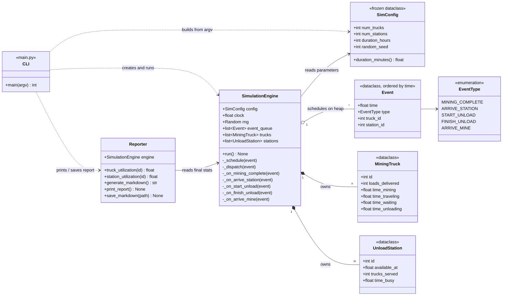
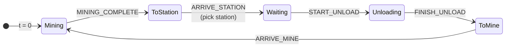

# `simulation` package

The simulation engine and everything it depends on. For the overall approach and the queueing design, see the [project README](../README.md).

| Module | Contents |
|---|---|
| [`config.py`](config.py) | Timing constants and the `SimConfig` dataclass |
| [`models.py`](models.py) | `Event`, `EventType`, `MiningTruck`, `UnloadStation` |
| [`engine.py`](engine.py) | `SimulationEngine`, the discrete-event loop |
| [`reporting.py`](reporting.py) | `Reporter`, which derives statistics and writes the Markdown report |

Typical use (this is what [`main.py`](../main.py) does):

```python
from simulation import Reporter, SimConfig, SimulationEngine

engine = SimulationEngine(SimConfig(num_trucks=10, num_stations=3, duration_hours=72, random_seed=42))
engine.run()
Reporter(engine).print_report()
```

## Class diagram



## Truck lifecycle

Every truck repeats this cycle until the clock reaches the configured duration. Waiting takes no time when a station is free.



## `config.py`: constants and parameters

Every timing rule from the spec is defined once here:

| Constant | Value | Meaning |
|---|---|---|
| `TRAVEL_TIME_MINUTES` | 30 | One-way trip between a mining site and the stations |
| `MIN_MINING_HOURS` / `MAX_MINING_HOURS` | 1 / 5 | Mining duration range (whole hours) |
| `MIN_UNLOAD_MINUTES` / `MAX_UNLOAD_MINUTES` | 30 / 60 | Unload duration range (whole minutes) |

`SimConfig` is a frozen dataclass holding `num_trucks`, `num_stations`, `duration_hours`, and an optional `random_seed`. Because it is frozen, nothing can change the parameters while a run is in progress. It raises `ValueError` if the trucks, stations, or duration are below 1, so invalid values are rejected whether they come from the CLI or from code.

All internal times are in **minutes**. `SimConfig.duration_minutes` converts the run length, and only `Reporter` converts back to hours.

## `models.py`: events and entities

- **`EventType`** is an enum of the five moments in a truck's cycle.
- **`Event`** has a `time`, a `type`, a `truck_id`, and an optional `station_id`. It is declared with `@dataclass(order=True)` and only `time` takes part in comparisons, so `heapq` can keep events in time order without a separate sort key.
- **`MiningTruck`** and **`UnloadStation`** hold state and running totals. They contain no logic, so the engine is the only place state changes.

## `engine.py`: the event loop

`SimulationEngine` owns the clock, the event queue, a private `random.Random(seed)`, and every truck and station.

```text
run():
    schedule a MINING_COMPLETE for every truck (random 1–5 h)
    while events remain:
        pop the earliest event
        if it is after the end time: stop
        move the clock to the event's time
        call the handler for its type
    move the clock to the end time
    credit every truck's (and station's) unfinished activity up to the end
```

`run()` can only be called once per engine; a second call raises `RuntimeError`. Create a new engine for another run.

Handlers are looked up in a dispatch table (`_HANDLERS`) keyed by `EventType`.

| Event | Handler records | Then schedules |
|---|---|---|
| `MINING_COMPLETE` | Time spent mining | `ARRIVE_STATION` in 30 min |
| `ARRIVE_STATION` | Time spent traveling; picks a station (see below) | `START_UNLOAD` and `FINISH_UNLOAD` at that station |
| `START_UNLOAD` | Time spent waiting in the queue (0 if the station was free) | nothing |
| `FINISH_UNLOAD` | Unload time, one delivered load, station busy time | `ARRIVE_MINE` in 30 min |
| `ARRIVE_MINE` | Time spent traveling | `MINING_COMPLETE` after a new random 1–5 h |

Each truck stores its current `TruckState` (mining, traveling, waiting, or unloading) and the time that state began. Every handler goes through one helper, `_transition`, which adds the elapsed time to that state's total and switches to the next state. When the run ends, the same accounting closes out whatever each truck is still doing, and an unload in progress also counts toward its station's busy time. As a result, each truck's four time totals always add up to the full duration.

### Choosing a station

Each `UnloadStation` stores `available_at`, the time it will next be free, counting every truck already assigned to it. When a truck arrives, `_on_arrive_station`:

1. picks the station with the smallest `available_at` (ties go to the lowest station id),
2. sets `unload_start = max(now, available_at)`,
3. rolls the unload duration **now** and moves `available_at` forward by it,
4. schedules `START_UNLOAD` at `unload_start` and `FINISH_UNLOAD` at `unload_start + duration`.

Because unload times are rolled when a truck arrives, every station's `available_at` is exact. The smallest value is therefore the true shortest wait. A free station always has the smallest value, which covers the "first available station" rule. A truck's events are fixed to one station once scheduled, which covers the "stays in its queue" rule.

### Reproducibility

The engine draws all random numbers from its own `random.Random(config.random_seed)` and never touches the global `random` module. The same seed always gives the same run, and tests can replace `engine.rng` with a stub to fix every duration (see [`tests/README.md`](../tests/README.md)).

## `reporting.py`: statistics

`Reporter` reads a finished engine. It never changes the engine's state.

| Metric | Formula |
|---|---|
| Truck utilization | (mining + traveling + unloading) ÷ duration. Waiting counts as idle. |
| Station utilization | busy time ÷ duration |
| Station idle time | duration − busy time |
| System throughput | total loads ÷ duration in hours |

`generate_markdown()` builds the report, `print_report()` prints it, and `save_markdown(path)` writes it to a file and creates any missing folders.

## Logging

Each module logs through the standard `logging` module under its own name (`simulation.engine`, `simulation.reporting`). The package attaches a `NullHandler` and never configures output itself, so importing it stays silent; the application decides where records go. `main.py` does this with `--log-level`, writing to stderr.

| Level | Logger | Message |
|---|---|---|
| `INFO` | `simulation.engine` | Run configuration at start; events processed and loads delivered at the end |
| `INFO` | `simulation.reporting` | Path of each saved report |
| `DEBUG` | `simulation.engine` | Every processed event, every station assignment (wait and unload time), events left unprocessed after the end time, and each truck's end-of-run credit |

Messages use `%`-style arguments rather than f-strings, so the per-event `DEBUG` calls cost almost nothing when that level is off.
